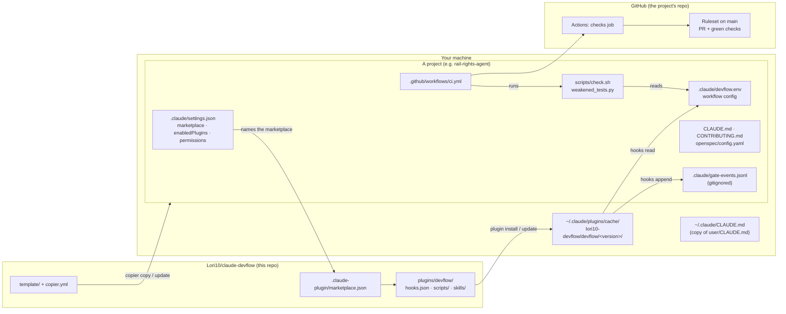
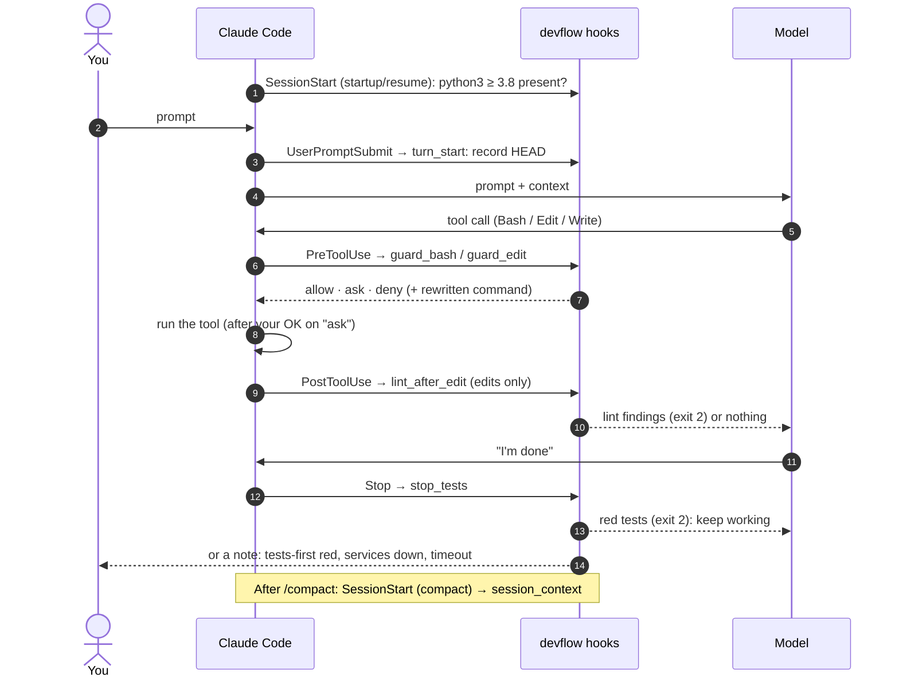
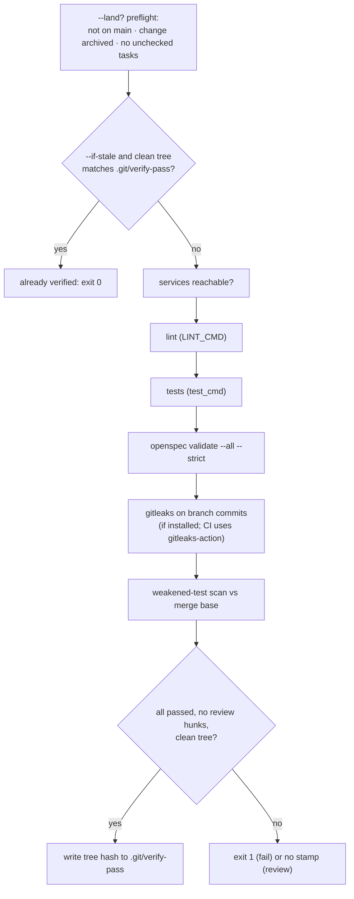

# How devflow works

This document follows the mechanics: where each piece lives, what runs at each step of a
change, how a hook reaches its decision, and how to change or debug the kit. The
[README](../README.md) has the reference tables (every rule, every config key); the
[guide](guide.md) explains why it is built this way. This page links to both instead of
repeating them.

## 1. Where everything lives



Each part has one home and one way of reaching a project:

| Part | Source of truth | Reaches a project by | Updated by |
|---|---|---|---|
| Hooks and skills | `plugins/devflow/` | Claude Code downloads it into the plugin cache when a project's `settings.json` enables it | Bumping `plugin.json`'s version, then `claude plugin update` |
| Project files | `template/` | `copier copy` writes them once | `copier update` merges template changes into the project |
| Workflow config | the project's `.claude/devflow.env` | Rendered by copier from your answers | You edit it (the edit guard asks first) |
| Personal defaults | `user/CLAUDE.md` | Copied by hand to `~/.claude/CLAUDE.md` | Copy again |
| Hard enforcement | GitHub ruleset | `scripts/setup_github.sh`, once per repo | Re-run or edit on GitHub |

Two files tie everything together:

- **`.claude/settings.json`** tells Claude Code which marketplace to trust and that
  `devflow@lori10-devflow` is enabled, plus the project's permission rules.
- **`.claude/devflow.env`** is the only place project-specific values live: the protected
  branch, the pinned OpenSpec version, test and lint commands, code paths, cloud and
  region. The hooks, `check.sh` and CI all read it, so they can't disagree.

## 2. The hooks and when they fire

`hooks/hooks.json` registers seven hooks on Claude Code's lifecycle events. Each one is a
Python script started fresh for every event: it reads one JSON object on stdin and answers
with an exit code and at most one JSON object on stdout.



| Event | Script | Reads | Effect |
|---|---|---|---|
| SessionStart `startup\|resume` | inline shell check | nothing | Warns visibly if `python3` ≥ 3.8 is missing, since every other hook needs it |
| UserPromptSubmit | `turn_start.py` | git | Writes `HEAD` to `<git-dir>/devflow-turn-start`; prints nothing |
| PreToolUse `Bash` | `guard_bash.py` | the command, `devflow.env`, git state | Returns allow / ask / deny with a reason; may rewrite the command |
| PreToolUse `Edit\|Write\|MultiEdit\|NotebookEdit` | `guard_edit.py` | the file path, `devflow.env` | Asks before edits to dependency files, `.env*` and the guard config |
| PostToolUse `Edit\|Write\|MultiEdit` | `lint_after_edit.py` | the file path, `LINT_CMD`, `LINT_GLOBS` | Runs the linter on that one file; findings go back to the model |
| Stop | `stop_tests.py` | git, turn-start file, `FAST_TEST_CMD`, paths | Runs the fast tests if the turn changed code; blocks the stop on red |
| SessionStart `compact` | `session_context.py` | git, `openspec/changes/` | Prints branch, dirty files, open changes and unchecked tasks |

What the exit codes mean to Claude Code:

| Exit | Meaning | devflow uses it for |
|---|---|---|
| 0 + JSON | Structured answer | PreToolUse decisions, `systemMessage` notes |
| 0, no output | Nothing to say | The common case: most commands pass silently |
| 2 + stderr | Block; stderr goes to the model | Lint findings, red tests at Stop |
| any other | Non-blocking error, shown to you | A hook's own crash (fail open, visibly) |

## 3. Anatomy of a guarded command

The model wants to run `uv run git push origin +main`. Here is what happens, with the real
output.

**1. Claude Code calls the hook** with the tool call on stdin:

```json
{"tool_name": "Bash",
 "tool_input": {"command": "uv run git push origin +main", "description": "Push"},
 "cwd": "/home/you/project"}
```

**2. Load context.** `guard_bash.py` finds the project root (`CLAUDE_PROJECT_DIR`), parses
`.claude/devflow.env` as plain `KEY=VALUE` lines (never executed) over the defaults, and
builds a context with the working directory and config.

**3. Split and normalize.** The command is tokenized with `shlex` (punctuation-aware), so
`&&`, `||`, `;`, `|`, unquoted newlines and backticks all separate segments, and quotes
are resolved the way bash resolves them. A command that can't be tokenized safely gets
**ask**, never a silent pass.

**4. Unwrap.** Each segment is stripped of what can hide the real program:

| Wrapper | Example | Becomes |
|---|---|---|
| Env assignments | `FOO=1 git push` | `git push` |
| `sudo`, `env`, `timeout`, `nice`, `nohup`, `xargs`, … | `timeout 60 git push` | `git push` |
| Runners | `uv run --with x git push`, `poetry run …`, `pipenv run …` | `git push` |
| Nested shells | `bash -c 'git push -f'`, `eval "…"` | the inner commands, parsed again |
| Substitution | `echo $(git push -f)` | inner command checked too |

Here, `uv run` is unwrapped and the segment becomes `git push origin +main`.

**5. Check.** Every segment runs through every checker that applies:

```
check_env_files  any segment       .env* tokens
check_git        git …             global -C/-c, commit, rebase, reset, clean, branch -D …
  check_push     git push          force forms, protected-branch targets, secret files
check_gh         gh …              pr merge, gh api writes, repo/secret settings
check_rm         rm -r             /, home, outside the project, .git
check_deps       uv/pip/npm/…      installs, removals, upgrades
check_cloud      aws/cdk/…         region, write calls, deploy/destroy
is_openspec      openspec …        pinning and read-only detection
```

`check_push` sees the `+` refspec (a force push) and the target `main` (the protected
branch). Both add **deny**.

**6. Combine.** The decision with the highest rank wins (deny > ask > allow; no decision
means silent pass), and all reasons are joined, so the model learns every problem at once.

**7. Answer and log.**

```json
{"hookSpecificOutput": {"hookEventName": "PreToolUse",
  "permissionDecision": "deny",
  "permissionDecisionReason": "Force-push is not allowed (it rewrites published history). Never push to main. Land changes through a PR (/devflow:land-branch)."}}
```

Every deny and ask is also appended to `.claude/gate-events.jsonl`:

```json
{"ts": "2026-10-31T12:47:48+0100", "hook": "guard_bash", "decision": "deny",
 "reason": "Force-push is not allowed …", "detail": "uv run git push origin +main"}
```

Other real decisions from the same run, for comparison:

| Command | Decision | Why |
|---|---|---|
| `git status` | (silent) | Nothing to check |
| `openspec list` | allow, rewritten to `npx --yes @fission-ai/openspec@1.15.0 list` | A single read-only call: pinned and allowed without a prompt |
| `openspec archive foundation` | ask, rewritten | Pinned, but it changes files, so you confirm |
| `git add . && git commit -m 'feat: x' && git reset --hard HEAD~1` | ask | The `reset --hard` segment decides for the whole chain |
| `aws s3 ls --region us-east-1` | deny | Outside the project region, even though it is read-only |

A rewrite is returned as `updatedInput`, which replaces the whole tool input, so the hook
copies every other field (such as `description`) and only swaps the command. A denied
command is never rewritten.

## 4. One change, end to end

What runs behind each step of the loop, using `foundation` in rail-rights-agent as the
example. The user-facing version of this table is the project's `CONTRIBUTING.md`.

| Step | What Claude does | What devflow does behind it |
|---|---|---|
| `/devflow:new-branch chore/foundation` | `git status`, `git switch main`, `git pull`, `git switch -c chore/foundation` | The skill stops if the tree is dirty and never stashes or resets on its own. `guard_bash` passes these commands silently. |
| `/opsx:propose foundation` | Writes `openspec/changes/foundation/` (proposal, spec deltas, design, tasks) | `openspec` calls are pinned to 1.15.0; `openspec/config.yaml` rules require the proposal to name new dependencies and billed resources, and the first task group to be failing tests. |
| You review | Revises with `/opsx:update` | No code yet; nothing for the Stop hook to test. |
| `/opsx:apply`, group 1 (tests) | Writes failing tests, commits | `turn_start` recorded `HEAD`; at Stop, only `tests/` changed, so red is reported as "tests-first red state" without blocking. |
| `/opsx:apply`, later groups | Adds `pyproject.toml`, code, CDK skeleton; commits per group | `uv add …` and edits to `pyproject.toml` **ask**. `lint_after_edit` lints each edited `.py` file. At Stop, code changed since the turn's `HEAD`, so the fast tests run; red blocks the stop and the failure goes back to Claude. |
| Push + draft PR | `git push -u origin chore/foundation`, `gh pr create --draft` | Pushing a feature branch passes; a force-push or a push to `main` would be denied. On a public repo, adding secret-looking files asks. CI starts. |
| `/devflow:verify` | Runs `scripts/check.sh`, reads the diff against `tasks.md` | See section 5. Reports `VERIFY: PASS/FAIL` with the gate output and any file changed outside the plan. |
| Live checks | (none for `foundation`; later changes: deploys, evals) | `cdk deploy` and AWS write calls **ask**; calls outside eu-north-1 are denied. |
| `/opsx:archive foundation` | Merges spec deltas into `openspec/specs/`, moves the change to `archive/YYYY-MM-DD-foundation/` | Pinned and asks, because it moves files. |
| `/devflow:land-branch` | `check.sh --if-stale --land`, push, `gh pr ready`, `gh pr checks --watch`, then asks you | `--land` fails while `openspec/changes/foundation/` still exists or the archived tasks have unchecked boxes. `--if-stale` skips the gates if this exact tree already passed. `gh pr merge` asks; `--admin` is denied. |
| Merge | `gh pr merge --merge --delete-branch`, `git switch main`, `git pull` | GitHub refuses the merge until `checks` is green: the ruleset is the final gate and has no bypass. |

## 5. `check.sh` and CI

`scripts/check.sh` is the full list of offline gates. `/devflow:verify`, `/devflow:land-branch`
and CI all run the same file.



- **Every gate runs**, even after one fails, so one run shows every problem.
- **The stamp** is the tree hash of a clean `HEAD` that passed. Uncommitted work never gets
  one. `--if-stale` only skips when the tree is identical, so it saves a rerun inside
  `/devflow:land-branch` and nothing else. CI never uses it.
- **The weakened-test scan** diffs test files against the merge base with
  `origin/<protected>`: removed asserts or test functions, added skips. It never fails the
  build on its own (some removals are legitimate), but a run with flagged hunks isn't
  stamped, so `/devflow:verify` has to read them first.
- **CI** (`.github/workflows/ci.yml`): checks out the full history (the scan needs the
  merge base), installs uv and Node, runs `uv sync --frozen` (so a lockfile is required),
  runs gitleaks-action, then `scripts/check.sh`. The job id `checks` is the required status
  check in the ruleset; renaming it would leave `main` unmergeable.

## 6. Changing the kit

### Add or change a rule

1. Write the test first. Most rules are one row in the decision table in
   `tests/test_guard_bash.py`: a command and the expected `allow`, `ask`, `deny` or `None`.
2. Run it and watch it fail: `uv run --group dev pytest tests/test_guard_bash.py -q`.
3. Change the matching checker in `plugins/devflow/scripts/guard_bash.py` (section 3 lists
   which checker handles which program).
4. Run everything: `uv run --group dev pytest -q` and
   `claude plugin validate . && claude plugin validate ./plugins/devflow`.
5. Branch, commit and open a PR; the kit's CI runs the suite on Python 3.10 and 3.12.

Keep to the existing conventions: stdlib only, Python 3.8 syntax, a clear reason string
for every decision, ask rather than deny when a command is sometimes legitimate.

### Release

1. Bump `version` in `plugins/devflow/.claude-plugin/plugin.json` (Claude Code updates
   plugins by version, so an unchanged version means no update).
2. Merge to `main`, then tag: `git tag v0.1.1 && git push origin v0.1.1`. Copier picks the
   newest tag.

### Pull a release into a project

```bash
# hooks and skills
claude plugin marketplace update lori10-devflow
claude plugin update devflow@lori10-devflow
# template files (inside the project, on a branch)
uvx copier update --trust
```

`copier update` does a three-way merge between the old template, the new template and
your edits; review the diff before committing. `CLAUDE.md` and `openspec/config.yaml` are
never touched after the first render.

## 7. Troubleshooting

| Symptom | Cause | Fix |
|---|---|---|
| No prompt to install devflow; `/plugin` doesn't list it | The folder was trusted before `.claude/settings.json` existed, so the one-time prompt never appeared | `claude plugin marketplace add Lori10/claude-devflow` and `claude plugin install devflow@lori10-devflow --scope project`, then restart the session. The install may reformat `settings.json`; `git checkout -- .claude/settings.json` restores it. |
| Plugin listed but hooks don't fire | Session started before the install, or `python3` is missing | Restart the session; check for the startup warning. |
| `Permission … denied to deploy key` on push | The machine's SSH key is a deploy key of another repo | Push over HTTPS with the `gh` login: `gh auth setup-git`, then `git remote set-url origin https://github.com/<owner>/<repo>.git`. |
| CI fails at `uv sync --frozen` with no `pyproject.toml` | A new project has no Python project yet | Expected until the first change adds `pyproject.toml` and `uv.lock`. |
| Every edit to `pyproject.toml` asks | The edit guard protects dependency files | Intended. While scaffolding, set `DEVFLOW_DEP_FILES=` in `devflow.env` and restore it afterwards. |
| A rule fires on something harmless | Pattern-based rules have false positives | Find it in `.claude/gate-events.jsonl`, add a test row with the expected decision, fix the checker (section 6). |
| Stop hook says tests were NOT run | A service in `DEVFLOW_SERVICES` is down, or the tests passed `DEVFLOW_STOP_TIMEOUT` | Start the service, or speed up `FAST_TEST_CMD` (`-x --ff` helps). |
| Stop hook never runs | `FAST_TEST_CMD` is empty, or the turn changed nothing under `CODE_PATHS` | Set them in `devflow.env`. |
| A hook prints "internal error (allowed through)" | A bug in the hook | The command ran without the guard. Report it with the command, add a test, fix. |

Reading the event log:

```bash
# which rules fire most
python3 -c "import json,collections; c=collections.Counter((e['decision'],e['reason'][:70]) for e in map(json.loads,open('.claude/gate-events.jsonl'))); [print(n,*k) for k,n in c.most_common(15)]"
```

An "ask" you approve nearly every time is a candidate for an allow; a deny that keeps
blocking legitimate work is a candidate for an ask.
